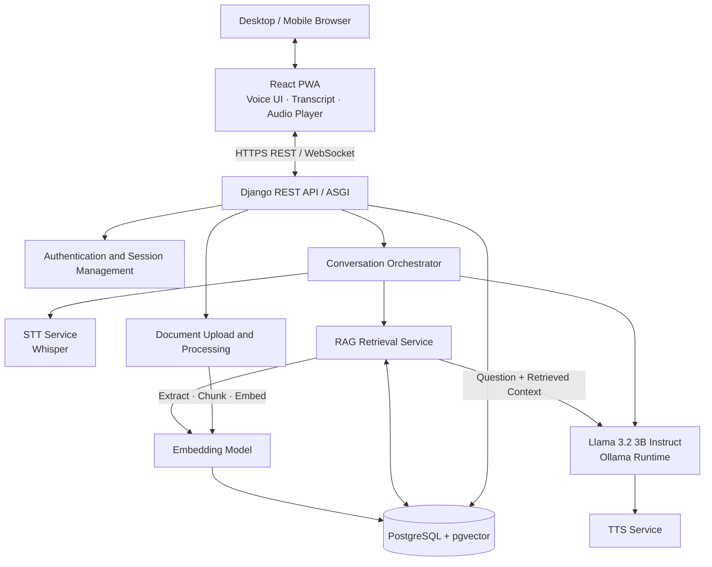
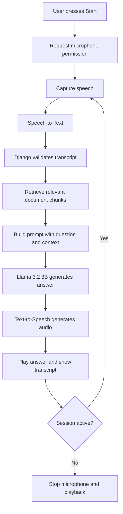
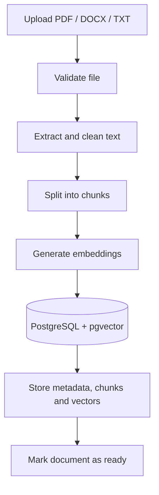

# SpeakSphere
# SpeakSphere AI 🎙️
### Speak Naturally. Discover Intelligently.

**SpeakSphere AI** is a cross-platform, RAG-based voice assistant designed to let users speak naturally with an AI system from desktop or mobile devices. It combines speech recognition, retrieval-augmented generation (RAG), a language model, and speech synthesis in one web application.

> **Project status:** In development. Features and architecture below describe the planned implementation; update this README as each module becomes operational.

---

## ✨ Key Features

- **Voice-first interaction:** Start and stop a voice conversation using one main button.
- **Speech-to-Text (STT):** Convert spoken questions into text.
- **AI-generated answers:** Generate responses with Llama 3.2 3B Instruct.
- **Retrieval-Augmented Generation (RAG):** Retrieve relevant information from uploaded documents before generating an answer.
- **Text-to-Speech (TTS):** Listen to the assistant's responses.
- **Multiple modes:** Conversation, STT-only, and TTS modes.
- **Cross-platform interface:** Responsive React web app designed for desktop and mobile.
- **Document knowledge base:** Planned support for PDF, DOCX, and TXT ingestion.
- **Conversation history and preferences:** Planned persistent history and user settings.

## 🧰 Technology Stack

| Layer | Technology |
|---|---|
| Frontend | React.js (PWA) |
| Backend | Django + Django REST Framework |
| Database | PostgreSQL |
| Vector search | pgvector |
| Main language model | Llama 3.2 3B Instruct |
| Local LLM runtime | Ollama |
| Speech-to-Text | Whisper or a compatible STT engine |
| Text-to-Speech | Piper or another compatible TTS engine |
| Embeddings | A compatible text embedding model, e.g. BGE-M3 |
| Optional background jobs | Celery + Redis |
| Communication | HTTPS REST; WebSocket for live events if required |

**Note:** Llama 3.2 3B Instruct is the conversational language model. STT, TTS, and the embedding model are separate components. Model choice and performance should be validated on the target hardware.

---

## 🏗️ Architecture



### Voice conversation flow



### RAG document ingestion flow



---

## 🔄 Planned Voice Session States

`IDLE → LISTENING → PROCESSING → SPEAKING → LISTENING`

The conversation should repeat until the user presses **Stop**. The implementation should handle microphone permissions, silence, network errors, interruption, and prevent the microphone from mistakenly transcribing the assistant's own audio.

## 📁 Suggested Repository Structure

```text
speaksphere-ai/
├── frontend/
│   ├── public/
│   ├── src/
│   │   ├── components/
│   │   ├── pages/
│   │   ├── hooks/
│   │   ├── services/
│   │   └── voice/
│   └── package.json
├── backend/
│   ├── config/
│   │   ├── settings.py
│   │   ├── urls.py
│   │   └── asgi.py
│   ├── apps/
│   │   ├── accounts/
│   │   ├── conversations/
│   │   ├── documents/
│   │   └── voice_sessions/
│   ├── services/
│   │   ├── llm_service.py
│   │   ├── embedding_service.py
│   │   ├── rag_service.py
│   │   ├── stt_service.py
│   │   └── tts_service.py
│   ├── manage.py
│   └── requirements.txt
├── tests/
├── .env.example
├── docker-compose.yml
└── README.md
```

This is a suggested structure; modules can be added as features are developed.

---

## 🗃️ Database Design (Planned)

| Entity | Purpose |
|---|---|
| Users | Accounts and preferences, using Django's user model |
| Conversations | Conversation owner, title, timestamps |
| Messages | User messages, assistant answers, timestamps |
| Documents | Uploaded file metadata, owner, processing status |
| Document chunks | Extracted text, document reference, chunk index |
| Chunk embeddings | Vectors for semantic retrieval; can be stored with chunks |
| Voice sessions | Mode, state, start and end timestamps |

Enable the PostgreSQL `vector` extension for pgvector. The embedding dimension in the database must match the selected embedding model. Retrieval must enforce document ownership and access permissions.

---

## 🚀 Development Roadmap

| Priority | Milestone | Completion criteria |
|---|---|---|
| P0 | Django + PostgreSQL setup | Database connection and migrations work |
| P0 | LLM integration | Text prompts return answers |
| P0 | Document ingestion | Files can be extracted and chunked |
| P0 | Embeddings + vector search | Relevant chunks are retrieved |
| P0 | RAG response generation | Answers use retrieved context |
| P0 | Responsive frontend | UI works at desktop and mobile widths |
| P0 | STT + TTS integration | Speech is transcribed and responses are audible |
| P0 | Continuous voice session | Start, listen, respond, repeat, and stop work reliably |
| P0 | Testing and HTTPS deployment | Tested on real devices; secrets protected |
| P1 | Authentication and history | Users can access their own conversations |
| P1 | Streaming and interruption handling | Playback can be stopped cleanly |
| P1 | PWA installation | Installable on supported devices |
| P2 | Background jobs and caching | Added when workload requires them |

---

## 🛠️ Local Development Setup

### Prerequisites

Install the following before starting:

- Python 3.11 or a compatible supported version
- Node.js LTS and npm
- PostgreSQL with the pgvector extension
- Git
- Ollama (for local LLM inference)

### 1. Clone the repository

```bash
git clone <your-repository-url>
cd speaksphere-ai
```

### 2. Set up the Django backend

```bash
cd backend
python -m venv .venv
```

Activate the environment:

**Windows (PowerShell):**
```powershell
.venv\Scripts\Activate.ps1
```

**macOS / Linux:**
```bash
source .venv/bin/activate
```

Install dependencies once `requirements.txt` has been created:

```bash
pip install -r requirements.txt
```

Configure database and application settings using environment variables, then run:

```bash
python manage.py migrate
python manage.py runserver
```

### 3. Set up the LLM

Install and start Ollama, then pull the model:

```bash
ollama pull llama3.2:3b
ollama run llama3.2:3b
```

Ensure the Django LLM service is configured to connect to the local Ollama endpoint. Model availability and hardware performance depend on the machine.

### 4. Set up the frontend

In a separate terminal:

```bash
cd frontend
npm install
npm run dev
```

Follow the local URL printed by the frontend development server.

> These are setup steps for the planned repository layout. The application will not run end-to-end until the corresponding source files, dependencies, environment configuration, and integrations have been implemented.

---

## 🔐 Security and Privacy

- Keep secrets and API keys in environment variables; never commit `.env`.
- Add `.env` to `.gitignore` and provide only placeholder values in `.env.example`.
- Use HTTPS in deployment because browser microphone access requires a secure context.
- Validate uploads, limit file size and supported formats, and treat document content as untrusted input.
- Enforce user ownership checks for conversations and retrieved documents.
- Configure authentication, CORS, CSRF protection, rate limits, timeouts, and safe error responses.
- Provide a way to delete stored conversations and uploaded documents.

## 🧪 Testing Checklist

- [ ] Text chat works with the selected LLM.
- [ ] Uploaded documents are extracted and indexed.
- [ ] RAG retrieves relevant chunks and avoids unsupported claims when context is missing.
- [ ] STT transcribes supported languages.
- [ ] TTS audio plays correctly.
- [ ] Start/Stop works repeatedly without leaving the microphone active.
- [ ] The assistant does not transcribe its own playback.
- [ ] Interruptions, silence, denied permissions and network failures are handled.
- [ ] Document access is isolated by user.
- [ ] The application is tested on desktop and mobile over HTTPS.

## 🤝 Contributing

1. Fork the repository.
2. Create a feature branch.
3. Make focused changes and add tests where appropriate.
4. Open a pull request with a clear description.

## 📄 License

Choose a license before publishing the project publicly. Add the appropriate `LICENSE` file and ensure that model and dependency licenses meet your intended use.

---

**SpeakSphere AI — Speak Naturally. Discover Intelligently.**
